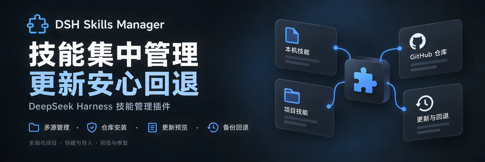
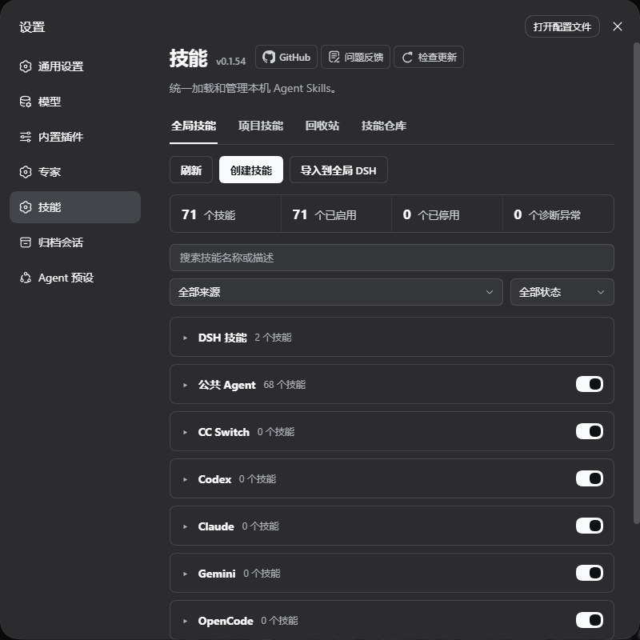
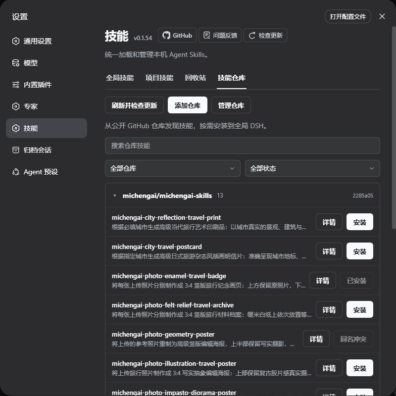

<p align="center">
  
</p>

<div align="center">

# DSH Skills Manager

  **Manage local and project skills in one place, install from GitHub, preview updates, and restore backups**

  [English](README.md) · [Changelog](CHANGELOG.zh-CN.md) · [Apache-2.0](LICENSE)

  [](LICENSE)
  [](https://www.npmjs.com/package/@michengai/dsh-skills-manager)
  [](https://www.npmjs.com/package/@michengai/dsh-skills-manager)
  [](https://github.com/MichengAI/dsh-skills-manager)
  [](#installation)
</div>

> DSH Skills Manager is a community-maintained DeepSeek Harness (DSH) plugin, not an official DeepSeek AI product.

This document describes **1.1.10**. See the [changelog](CHANGELOG.zh-CN.md) and [latest release notes](https://github.com/MichengAI/dsh-skills-manager/releases/latest).

## Features

Bring skills scattered across your computer and projects together in DSH, without searching through multiple Agent directories.

- **Manage in one place**: browse skills grouped by source, search, read their contents, and enable or disable them with one click.
- **Separate global and project skills**: the project tab follows the current session, and project copies take priority over copies with the same name elsewhere.
- **Reuse existing skills**: supports common Agents such as Codex, Claude Code, and Copilot; toggling a skill does not modify its source files.
- **Create and import**: create skills or import ZIP archives, skill folders, and `SKILL.md` files into global DSH.
- **Trash and restore**: deleted DSH skills go to Trash first, where accidentally deleted skills can be recovered.
- **Skill repositories**: add public GitHub repositories, browse them in collapsible source groups, search, view details, and install skills individually. Existing skills with the same name are not overwritten, and refreshing does not automatically update local files.
- **Track sources and updates**: distinguish local skills from repository installs, preview file differences, protect local changes, and back up before updating; restore the previous version when needed.

## Screenshots

Skill management:



Skill repositories:



*Screenshots are from the 0.1.54 local test build prepared before the 1.0.0 release. They show global skills and the skill repository; the final release adds refresh animation and progress feedback. Only feature panels are shown. Real filenames and project directories have been cropped from the background. Images use lossless WebP.*

## Installation

Requires an installed and working DeepSeek Harness. The commands below use the `web` profile; replace it with the profile for your environment.

Plugin installation supports the npm registry, locally built `.tgz` packages, and GitHub. GitHub and npm packages include a ready-to-run `lib`. After changing source code, run the build before committing.

### Ask an Agent to install it

Send this to an Agent that can use your local terminal:

```text
Install the latest @michengai/dsh-skills-manager into my DSH web profile using the official npm registry. Confirm that it is active and explain how to reload DSH.
```

### Install manually

```powershell
[Console]::OutputEncoding = [System.Text.Encoding]::UTF8
$OutputEncoding = [System.Text.Encoding]::UTF8
dsh plugin --profile web add @michengai/dsh-skills-manager@latest --registry=https://registry.npmjs.org/
```

After installation, restart DSH and refresh the page, then open **Settings → Skills**. To update, click **Check for updates** or run the installation command again.

- Version `1.1.10` has been verified with DeepSeek Harness `0.1.2-rc.1`, `0.1.5-rc.1`, `0.1.5-rc.2`, `0.1.5-rc.3`, `0.1.7-rc.1`, `0.1.7-rc.2`, `0.2.0-rc.1`, and `0.2.0-rc.2`.

## Usage

| What you want to do | How |
| --- | --- |
| Find a skill | Select the Global or Project tab, expand a source group, or use search and filters. |
| View content | Click **View details** to read the skill body and source information. |
| Enable or disable | Toggle the skill switch. This affects DSH only and does not modify the source files. |
| Add a skill | Click **Create skill** or **Import to global DSH**. |
| Install from a repository | Open **Skill repositories → Add repository**, enter a public GitHub URL, scan it, and install skills individually. |
| Update repository skills | Click **Refresh and check for updates**, then **View updates** to preview file differences and confirm a backed-up update. |
| Restore the previous version | For a skill with a backup, click **Restore previous version**, preview the changes, and confirm. |
| Recover a deleted skill | Open **Trash** and restore it. To restore a project skill, return to the original project's session first. |

- **Project skills follow the current session**: for Git repositories, the project root is the nearest Git root; for ordinary folders, it is the current session's working directory. You do not need to run `git init`.
- **Same-named skills can be enabled independently**: after disabling a project copy, another enabled copy can take over, and the page identifies the active source. To disable the skill entirely, disable every copy.
- **File management scope**: only skills from DSH sources can be moved to Trash. Skills from other Agents can be viewed and enabled or disabled. Skills created or imported by the manager are always saved to global DSH.

### Repository limitations

- **Check for updates** in the title area updates the plugin itself. **Refresh and check for updates** in the repository area checks skill contents and does not install or replace them automatically. Refresh displays the current repository, item count, and progress animation.
- Repository installs write only to global DSH. Only public GitHub repositories are supported; private credentials and automatic updates are not provided. Removing a subscription leaves installed skills in place.
- Repository archives are limited to 32 MiB. Selecting a subdirectory still requires downloading the entire repository. A scan failure preserves the previous directory; refresh again if the cache is damaged.
- Local changes are checked before updates, and replacement requires explicit confirmation. Historical backups are not automatically cleaned up and use additional disk space.

## Supported Agent directories

`~` represents the user's home directory, and `<project>` represents the current session's project root. The table shows default paths; configured DSH directory variables take precedence.

| Source | Global directory | Project directory |
| --- | --- | --- |
| DSH | `~/.dsh/skills` | `<project>/.dsh/skills` |
| Common Agents | `~/.agents/skills` | `<project>/.agents/skills` |
| CC Switch | `~/.cc-switch/skills` | — |
| Codex | `~/.codex/skills` | `<project>/.codex/skills` |
| Claude Code | `~/.claude/skills` | `<project>/.claude/skills` |
| Gemini | `~/.gemini/skills` | `<project>/.gemini/skills` |
| OpenCode | `~/.config/opencode/skills` | `<project>/.opencode/skills` |
| Cursor | `~/.cursor/skills` | `<project>/.cursor/skills` |
| Copilot | `~/.copilot/skills` | `<project>/.github/skills` |
| Windsurf | `~/.codeium/windsurf/skills`<br>`~/.windsurf/skills` | `<project>/.windsurf/skills` |
| Trae | `~/.trae/skills` | `<project>/.trae/skills` |
| Trae CN | `~/.trae-cn/skills` | `<project>/.trae-cn/skills` |
| OpenClaw / Clawdbot | `~/.openclaw/skills`<br>`~/.clawdbot/skills` | — |
| Roo | `~/.roo/skills` | `<project>/.roo/skills` |
| CodeBuddy | `~/.codebuddy/skills` | `<project>/.codebuddy/skills` |
| WorkBuddy | `~/.workbuddy/skills` | `<project>/.workbuddy/skills` |
| Qoder | `~/.qoder/skills` | `<project>/.qoder/skills` |
| Qoder CN CLI | `~/.qoder-cn/skills` | — |
| Qoder CN IDE | `~/.lingma/skills` | `<project>/.lingma/skills` |
| Project Skills | — | `<project>/skills` |

The generic `<project>/skills` directory is shown as **Project Skills** and can also read OpenClaw workspace skills. Qoder CN CLI project skills are in `<project>/.qoder/skills` and are shown as Qoder. Qoder CN IDE uses the Lingma directory. External source directories that do not exist are not shown.

## DSH ecosystem

For a desktop workstation, download [DSH Codex Desktop](https://github.com/MichengAI/dsh-codex-desktop/releases). If you already use [DeepSeek Harness](https://github.com/deepseek-ai/deepseek-harness), install projects as needed by following their READMEs. The table below lists 11 independently developed plugins; the desktop bundle contents depend on the release notes and built-in manifest for that version.

| Plugin | What it does |
| --- | --- |
| [Codex UI](https://github.com/MichengAI/dsh-codex-ui) | Organize projects and sessions, search tasks, and jump to conversation turns |
| [Agency Agents](https://github.com/MichengAI/dsh-agency-agents) | Choose and summon specialist personas for tasks |
| [Skills Manager](https://github.com/MichengAI/dsh-skills-manager) | Manage local and project skills; install, update, and restore them from repositories |
| [Archive Manager](https://github.com/MichengAI/dsh-archive-manager) | Search, restore, or clean up archived sessions |
| [IM Connect](https://github.com/MichengAI/dsh-im-connect) | Assign tasks and receive replies through messaging platforms |
| [Automation](https://github.com/MichengAI/dsh-automation) | Run scheduled tasks and review each run's results |
| [BTW](https://github.com/MichengAI/dsh-btw) | Ask a temporary side question in the current context without interrupting the main task |
| [Simplify](https://github.com/MichengAI/dsh-simplify) | Refactor code within the current Git change scope using `/simplify` |
| [PUA](https://github.com/MichengAI/dsh-pua) | Encourage Agents to try another approach, investigate failures, and verify results before finishing |
| [Code Review](https://github.com/MichengAI/dsh-code-review) | Start an independent Agent code review with `/review` and receive the report in the current session |
| [Codex Pet](https://github.com/MichengAI/dsh-codex-pet) | Use a desktop pet to view session reminders, handle tool approvals, and answer questions |

## Feedback and contributions

For issues or suggestions, please [open an issue](https://github.com/MichengAI/dsh-skills-manager/issues). Include DSH and plugin versions and reproduction steps; for UI issues, attach a full screenshot.

Source code is in `src`, uses strict TypeScript, and retains the existing plugin architecture. Run `npm run typecheck` for type checking, `npm run build` to generate runtime artifacts, and `npm run verify` for full regression and package validation. GitHub and npm packages include a ready-to-run `lib`. After changing source code, run the build before committing. Packaging also checks types and builds the JavaScript artifacts required by the npm package. CI runs full validation on Node.js 22.19.0 and 24, and code changes automatically trigger the supported-host compatibility matrix. Contributions are welcome.

To create a test package from a source checkout, install dependencies using the pinned pnpm version, run `npm run verify`, then run `npm pack`. Install the generated `.tgz` with `dsh plugin --profile web add <package.tgz>`, then restart DSH and refresh the page. Do not use `--ignore-scripts` when packing, because it skips the build hook.

## License

[Apache License 2.0](LICENSE)

BC 提供六个可检查的初始工作流，包括 LaTeX 论文和报告。单独安装 LaTeX 技能可复用现有 TeX Live 或 MiKTeX，并保留模板、参考文献和可编辑源文件。运行时安装和 PDF 编译成功需要单独检查。
