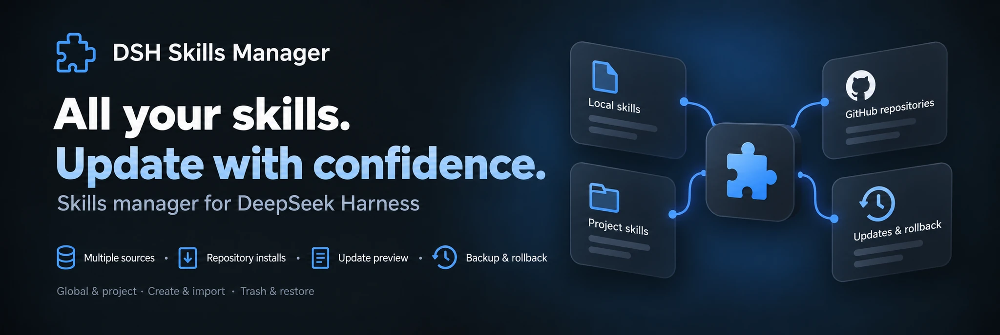

<p align="center">
  
</p>

<div align="center">

# DSH Skills Manager

[English](README.md) | 中文

  **管理本地及项目 skill（技能），从 GitHub 安装，预览更新并恢复备份**

  [简体中文](README.zh-CN.md) · [更新日志](CHANGELOG.md) · [Apache-2.0](LICENSE)

  [](LICENSE)
  [](https://www.npmjs.com/package/@michengai/dsh-skills-manager)
  [](https://www.npmjs.com/package/@michengai/dsh-skills-manager)
  [](https://github.com/MichengAI/dsh-skills-manager)
  [](#installation)
</div>

> DSH Skills Manager 是社区维护的 BharatCode Harness（DSH）插件，不是 DeepSeek AI 官方产品。

本 README 描述 **1.1.10**。参见[更新日志](CHANGELOG.md)和[发布说明](https://github.com/MichengAI/dsh-skills-manager/releases/latest)。

## 功能


将电脑和项目中的 skill 汇集到 DSH，无需在 Agent 文件夹间切换。

- **集中管理**：浏览可折叠的来源分组，搜索、阅读并切换 skill。
- **全局及项目 skill**：项目标签页跟随当前会话，项目副本优先于全局副本。
- **复用现有 skill**：支持 Codex、Claude Code、Copilot 等 agent（智能体），切换时不修改其源文件。
- **创建与导入**：创建 skill，或将 ZIP 归档、文件夹及 `SKILL.md` 文件导入全局 DSH。
- **Skill 仓库**：发现公开 GitHub skill，安装时不覆盖本地文件，审查更新并恢复备份。
- **恢复已删除 skill**：DSH skill 先进入 Trash，因此误删可恢复。

- **来源跟踪与更新**：区分本地及仓库 skill，预览文件变更，保护本地编辑，并确认备份、更新或回滚。

## 截图

Skill 管理：


Skill 仓库：


*截图展示为准备 1.0.0 而使用的发布前 0.1.54 本地构建。最终版本添加刷新动画和进度反馈。截图仅展示功能面板，背景中的真实文件名和项目目录已裁剪，图片使用无损 WebP。*

<a id="installation"></a>
## 安装

需要可正常运行的 BharatCode Harness 安装。以下命令使用 `web` profile；必要时替换为你的 profile。

支持的插件安装来源包括 npm 注册表、本地构建的 `.tgz` 包和 GitHub。GitHub 和 npm 均包含可直接运行的 `lib`。更改源代码后，提交前运行构建。

### 请 agent 安装

将以下内容发送给能够使用本地终端的 agent：

```text
Install the latest @michengai/dsh-skills-manager into my DSH web profile using the official npm registry. Confirm installation and explain how to reload DSH.
```

### 手动安装

```powershell
[Console]::OutputEncoding = [System.Text.Encoding]::UTF8
$OutputEncoding = [System.Text.Encoding]::UTF8
dsh plugin --profile web add @michengai/dsh-skills-manager@latest --registry=https://registry.npmjs.org/
```

重启 DSH、刷新页面并打开 **Settings → Skills**。更新时选择 **Check for updates** 或重新运行安装命令。

- 插件 `1.1.10` 已使用以下 BharatCode Harness 版本测试： `0.1.2-rc.1`, `0.1.5-rc.1`, `0.1.5-rc.2`, `0.1.5-rc.3`, `0.1.7-rc.1`, `0.1.7-rc.2`, `0.2.0-rc.1`, `0.2.0-rc.2`.

## 使用

筛选控件根据 Skills 分区的宽度调整布局：在较窄的设置面板中，搜索框移至来源和状态筛选器下方，仓库筛选器则纵向排列。

| 目标 | 方法 |
| --- | --- |
| 查找 skill | 选择 Global 或 Project，展开来源分组，或使用搜索和筛选。 |
| 阅读内容 | 选择 **View details** 查看 skill 正文及来源信息。 |
| 启用或禁用 | 切换 skill 开关。它影响 DSH，但不编辑源文件。 |
| 添加 skill | 选择 **Create skill** 或 **Import into global DSH**。 |
| 从仓库安装 | 打开 **Repositories → Add repository**，输入公开 GitHub URL，扫描并逐个安装 skill。 |
| 更新仓库 skill | 选择 **Refresh & check updates**，再选择 **Review update** 检查变更并确认备份和更新。 |
| 回滚更新 | 对有备份的 skill 选择 **Restore previous version**，预览并确认。 |
| 恢复删除 | 打开 **Trash** 并恢复。对于项目 skill，先返回原项目中的会话。 |

- **仅当前项目**：Git 仓库使用最近的 Git 根目录。其他文件夹使用当前会话工作目录；无需 `git init`。
- **独立副本**：禁用项目副本后，另一个已启用副本可以接替，面板显示活动来源。禁用全部副本才能完全关闭 skill。
- **文件管理**：仅 DSH skill 可移入 Trash。其他 Agent skill 可查看和切换。创建和导入始终保存到全局 DSH。

### 仓库边界

- 页头的 **Check for updates** 更新插件本身。仓库的 **Refresh & check updates** 检查 skill 内容，但不安装或替换；它显示动画、计数和当前仓库。
- 仓库安装仅面向全局 DSH。支持公开 GitHub 仓库；不支持私有凭据及自动更新。移除订阅会保留已安装 skill。
- 归档限制为 32 MiB，按子目录筛选时也适用。扫描失败保留原目录；缓存损坏时需要刷新。
- 替换本地编辑前需要明确确认。历史备份不会自动清理，并占用额外磁盘空间。

## 支持的 Agent 目录

`~` 表示 home 目录；`<project>` 是当前会话项目根目录。以下为默认路径；已配置的 DSH 目录变量优先。

| 来源 | 全局目录 | 项目目录 |
| --- | --- | --- |
| DSH | `~/.dsh/skills` | `<project>/.dsh/skills` |
| Shared Agent | `~/.agents/skills` | `<project>/.agents/skills` |
| CC Switch | `~/.cc-switch/skills` | — |
| Codex | `~/.codex/skills` | `<project>/.codex/skills` |
| Claude Code | `~/.claude/skills` | `<project>/.claude/skills` |
| Gemini | `~/.gemini/skills` | `<project>/.gemini/skills` |
| OpenCode | `~/.config/opencode/skills` | `<project>/.opencode/skills` |
| Cursor | `~/.cursor/skills` | `<project>/.cursor/skills` |
| Copilot | `~/.copilot/skills` | `<project>/.github/skills` |
| Windsurf | `~/.codeium/windsurf/skills`<br>`~/.windsurf/skills` | `<project>/.windsurf/skills` |
| Trae | `~/.trae/skills` | `<project>/.trae/skills` |
| Trae CN | `~/.trae-cn/skills` | `<project>/.trae-cn/skills` |
| OpenClaw / Clawdbot | `~/.openclaw/skills`<br>`~/.clawdbot/skills` | — |
| Roo | `~/.roo/skills` | `<project>/.roo/skills` |
| CodeBuddy | `~/.codebuddy/skills` | `<project>/.codebuddy/skills` |
| WorkBuddy | `~/.workbuddy/skills` | `<project>/.workbuddy/skills` |
| Qoder | `~/.qoder/skills` | `<project>/.qoder/skills` |
| Qoder CN CLI | `~/.qoder-cn/skills` | — |
| Qoder CN | `~/.lingma/skills` | `<project>/.lingma/skills` |
| Project Skills | — | `<project>/skills` |

通用 `<project>/skills` 目录标为 **Project Skills**，也支持 OpenClaw 工作区 skill。Qoder CN CLI 项目 skill 使用 `<project>/.qoder/skills` 并显示为 Qoder。Qoder CN IDE 使用 Lingma 目录。不显示不存在的外部来源目录。

## DSH 产品生态

需要桌面工作台时，下载 [DSH Codex Desktop](https://github.com/MichengAI/dsh-codex-desktop/releases)。现有 [BharatCode Harness](https://github.com/deepseek-ai/deepseek-harness) 安装可按各项目 README 按需添加插件。以下为 11 个第一方插件；各版本包含的内容以相应桌面发布说明及随附目录为准。

| 插件 | 功能 |
| --- | --- |
| [Codex UI](https://github.com/MichengAI/dsh-codex-ui) | 组织项目和对话、搜索任务并导航聊天轮次 |
| [Agency Agents](https://github.com/MichengAI/dsh-agency-agents) | 为任务选择并召集专家 |
| [Skills Manager](https://github.com/MichengAI/dsh-skills-manager) | 管理本地及项目 skill；安装、更新和回滚仓库 skill |
| [Archive Manager](https://github.com/MichengAI/dsh-archive-manager) | 搜索、恢复或清理归档对话 |
| [IM Connect](https://github.com/MichengAI/dsh-im-connect) | 通过消息平台发送任务并接收回复 |
| [Automation](https://github.com/MichengAI/dsh-automation) | 安排任务并审查每次运行 |
| [BTW](https://github.com/MichengAI/dsh-btw) | 提出旁支问题而不中断主任务 |
| [Simplify](https://github.com/MichengAI/dsh-simplify) | 使用 `/simplify` 改进 Git 变更范围内的代码 |
| [PUA](https://github.com/MichengAI/dsh-pua) | 引导 Agent 在失败后尝试新方法、调查原因并在完成前验证结果 |
| [Code Review](https://github.com/MichengAI/dsh-code-review) | 使用 `/review` 请求独立 Agent 代码审查，并在当前对话接收报告 |
| [Codex Pet](https://github.com/MichengAI/dsh-codex-pet) | 通过桌面宠物查看对话通知并回应工具审批和问题 |

## 反馈与贡献

发现问题或提出建议时，请[提交 issue](https://github.com/MichengAI/dsh-skills-manager/issues)。提供 DSH 及插件版本、复现步骤；UI 问题还需完整截图。

源代码位于 `src`，使用严格 TypeScript 并保留现有插件架构。运行 `npm run typecheck` 检查类型，`npm run build` 生成运行时文件，`npm run verify` 执行完整回归和包检查。GitHub 和 npm 均包含可直接运行的 `lib`。更改源代码后，提交前运行构建。打包仍会检查类型，并构建 npm 包所需 JavaScript 文件。CI 在 Node.js 22.19.0 和 24 上运行完整验证，代码变更也会触发支持宿主的兼容性矩阵。欢迎贡献。

测试源代码 checkout 时，使用固定 pnpm 版本安装依赖，运行 `npm run verify`，再运行 `npm pack`。通过 `dsh plugin --profile web add <package.tgz>` 安装生成的 `.tgz`，重启 DSH 并刷新页面。打包时不要使用 `--ignore-scripts`：它会跳过构建钩子。

## 许可证

[Apache 许可证 2.0](LICENSE)

BC 包含六个可检查的初始工作流，包括 LaTeX 论文和报告。单独安装 LaTeX skill 可以复用现有 TeX Live 或 MiKTeX，并保留模板、参考文献及可编辑源文件。运行时安装和 PDF 编译成功需要分别检查。
