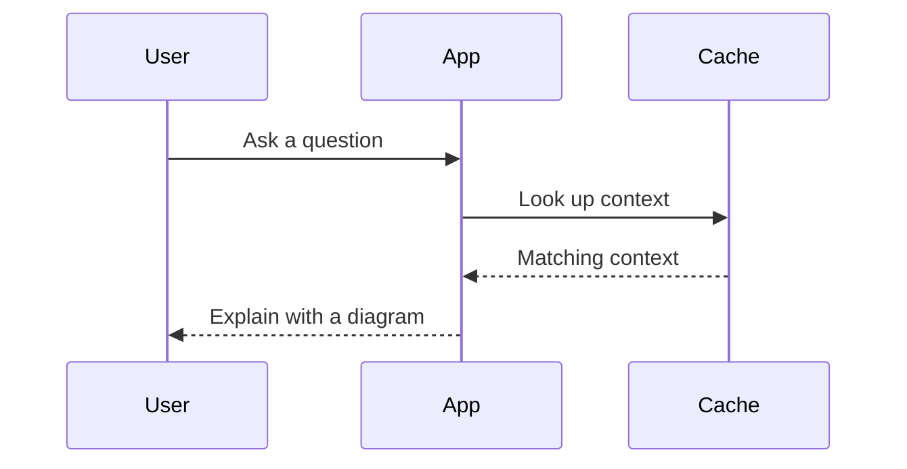

# DSH Visuals

Polished inline charts and diagrams for DeepSeek Harness. Graphics appear beside the part of an answer they explain, with readable typography, restrained colour, light/dark themes, exact data tables and editable source. All rendering happens locally.

## Included

- Seven original designs: metrics with sparklines, signed bars, multi-series lines, compact flowcharts, timelines, step-by-step procedures and donuts.
- The full Mermaid 12.1 engine, plus ZenUML. The gallery exercises 21 Mermaid families, including database relationships, sequences, classes, states, mind maps, Gantt schedules, architecture, Sankey, radar and treemaps. Other engine-supported families are forwarded to Mermaid as well.
- Source preview editing, copy source and portable SVG export. Edits affect the current preview only; the stored conversation stays unchanged.
- A plugin settings gallery and English controls for every locale. The model can author diagrams in the user's language.
- Native chat rendering for prose, reasoning, images, tools and other content. The wrapper uses the published slot API and restores the original renderer on unload.

This is an original design inspired by the idea of rich visuals in conversation. No OpenGhost code, visual assets or animations are included.

## Install

Requires Harness 0.2.0-rc.2 or newer with the current assistant chat slot and client module loader. Use the installation's own `dsh` CLI and `DSH_HOME`; Desktop keeps a separate `desktop` profile. Wait for running agents and package operations to finish before changing it.

```bash
DSH_HOME=/path/to/installation/home dsh plugin --profile desktop add /absolute/path/to/local-dsh-visuals-0.1.0.tgz
```

The normal Harness package manager discovers `dsh.bundle.patch` and adds the bundle. Restart the idle app and open its plugin settings to find the Visuals gallery. Start a conversation and ask, for example:

> Compare three training-loss curves using illustrative data, explain them, and show a sequence diagram of a request flowing through a cache and database.

For this checkout, the optional `scripts/install.mjs` helper checks the live Marketplace agent guard, backs up profile metadata and runs the official CLI. It refuses to modify a busy host. Use the native package installer and session status to verify the intended host is idle. The old Marketplace-specific installer is not shipped in this fork.

```bash
node scripts/install.mjs --home /path/to/installation/home --cli /path/to/dsh --dry-run
node scripts/install.mjs --home /path/to/installation/home --cli /path/to/dsh
```

Use a `.js` CLI entry path if your installation exposes its built CLI through Node. To uninstall, use `dsh plugin --profile desktop remove @local/dsh-visuals` with the same `DSH_HOME`, then restart while idle. No Harness source patch is required.

## Authoring

Put a top-level fenced block at the place where a visual belongs:

````markdown
```visual
bars
title Monthly costs (illustrative)
unit ₹
caption Example values, not account data
Hosting | 1200 | Server and storage
Tools | 800
Refund | -200
```


````

Custom syntax examples are in `src/examples.js`; standard Mermaid examples are in `src/diagram-examples.js`. Numeric chart data must be finite plain numbers. Metrics allow formatted display values. Use short labels and add captions for provenance or uncertainty. The host prompt supplies these instructions to the model only while the plugin is loaded.

Mermaid styling and security configuration belong to the plugin. Diagram-authored init directives and YAML configuration are ignored. Scripts, click actions, HTML labels, external images and network CSS are excluded from the displayed SVG. Icons requiring an external icon pack are not fetched. Limits are 64 KiB per source and 240 Mermaid edges; custom charts have smaller row/series limits. Invalid Mermaid shows a readable syntax error and source. Invalid custom blocks remain native code.

## Develop and preview

Node 22.12 or newer:

```bash
npm ci --ignore-scripts
npm test
npm run build
npm run preview
```

Open `http://127.0.0.1:19391`. The preview uses the same components as the plugin. `npm pack` creates a prebuilt installable archive. Runtime browser libraries are bundled locally; installing the archive does not need a build or runtime dependencies. The bundle is about 8 MiB uncompressed because it includes all diagram renderers. Source maps are omitted from the archive.

`node --expose-internals scripts/composition-smoke.mjs` checks the real installed Harness Loader and slot service in an isolated fixture. This machine-specific check uses `/home/sushi/Applications/deepseek-harness-source`; update its paths to run elsewhere. It does not change the desktop profile.

## Current boundaries

Only top-level visual fences are intercepted. Fences inside lists or block quotes remain native code. Prose segments preserve link-reference definitions, but Markdown footnote numbering and automatic list continuation across a graphic are not globally coordinated. Dense diagrams scroll horizontally on narrow screens to preserve legibility. Preview edits reset on remount or source changes.

See `VALIDATION.md` for what has been verified and what still requires live activation.

Charts are immediately available from the standard core client. The diagram engine is shipped in `lib/client.mermaid.js` and loaded through BC’s package-local module loader on the first diagram request. This is a local bundled asset: no network service, extra installation, or enable switch is required. Licence inventories cover both modules.
