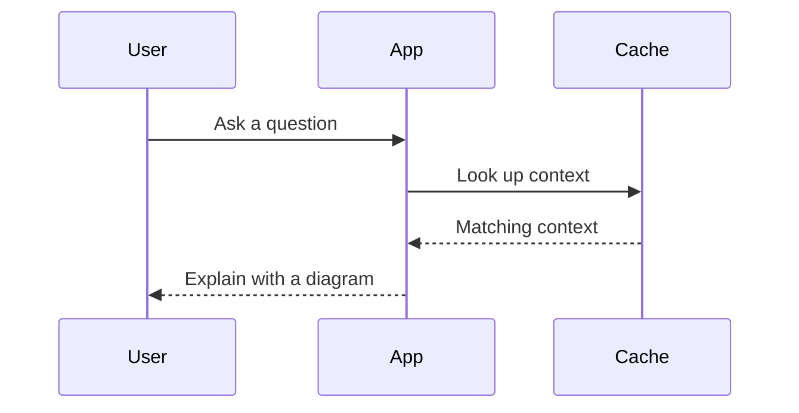

# DSH Visuals

[English](README.md) | 中文

为 DeepSeek Harness 提供精致的内联图表和示意图。图形位于所解释的回答段落旁，采用易读字体、克制配色、浅色/深色主题、准确数据表及可编辑源内容。所有渲染均在本地进行。

## 包含内容

- 七种原创设计：带迷你趋势图的指标、正负条形图、多序列折线图、紧凑流程图、时间线、分步流程及环形图。
- 完整 Mermaid 12.1 引擎以及 ZenUML。图库验证 21 类 Mermaid 图形，包括数据库关系、时序、类、状态、思维导图、甘特计划、架构、桑基、雷达和矩形树图。引擎支持的其他图形类型也会转发给 Mermaid。
- 源内容预览编辑、复制源内容及可移植 SVG 导出。编辑只影响当前预览；已保存对话保持不变。
- 插件设置图库以及所有语言下的英文控件。模型可以用用户语言编写图表。
- 对正文、推理、图片、工具及其他内容保留原生聊天渲染。包装层使用已发布的 slot API，卸载时恢复原始渲染器。

这是受对话中丰富视觉呈现理念启发的原创设计。不包含 OpenGhost 代码、视觉资产或动画。

## 安装

需要 Harness 0.2.0-rc.2 或更新版本，具备当前 assistant 聊天 slot 和客户端模块 loader。使用该安装自身的 `dsh` CLI（命令行界面）和 `DSH_HOME`；Desktop 保留独立 `desktop` profile。更改前等待正在运行的 agent（智能体）和包操作结束。

```bash
DSH_HOME=/path/to/installation/home dsh plugin --profile desktop add /absolute/path/to/local-dsh-visuals-0.1.0.tgz
```

常规 Harness 包管理器会发现 `dsh.bundle.patch` 并添加组合包。应用空闲时重启，打开插件设置查看 Visuals 图库。开始对话并提出请求，例如：

> 使用示例数据比较三条训练损失曲线，解释它们，并展示请求流经缓存和数据库的时序图。

此 checkout 中可选的 `scripts/install.mjs` 辅助脚本会检查实时 Marketplace agent 防护、备份 profile 元数据并运行官方 CLI。它拒绝修改繁忙宿主。使用原生包安装器和会话状态确认目标宿主空闲。旧 Marketplace 专用安装器未随此 fork 交付。

```bash
node scripts/install.mjs --home /path/to/installation/home --cli /path/to/dsh --dry-run
node scripts/install.mjs --home /path/to/installation/home --cli /path/to/dsh
```

若安装通过 Node 暴露已构建 CLI，请使用 `.js` CLI 入口路径。卸载时使用同一 `DSH_HOME` 运行 `dsh plugin --profile desktop remove @local/dsh-visuals`，然后在空闲时重启。无需 Harness 源代码 patch。

## 编写

在需要图形的位置放置顶层围栏块：

````markdown
```visual
bars
title Monthly costs (illustrative)
unit ₹
caption Example values, not account data
Hosting | 1200 | Server and storage
Tools | 800
Refund | -200
```


````

自定义语法示例位于 `src/examples.js`；标准 Mermaid 示例位于 `src/diagram-examples.js`。数字图表数据必须是有限的普通数字。指标允许格式化显示值。使用简短标签，并添加说明交代来源或不确定性。宿主提示词仅在插件加载期间向模型提供这些指令。

Mermaid 样式和安全配置由插件负责。忽略图表内的 init 指令和 YAML 配置。显示的 SVG 排除脚本、点击操作、HTML 标签、外部图片和网络 CSS。不获取需要外部图标包的图标。每份源内容限制为 64 KiB，Mermaid 限制为 240 条边；自定义图表具有更小的行/序列限制。无效 Mermaid 显示易读的语法错误及源内容。无效自定义块仍显示为原生代码。

## 开发与预览

需要 Node 22.12 或更新版本：

```bash
npm ci --ignore-scripts
npm test
npm run build
npm run preview
```

打开 `http://127.0.0.1:19391`。预览与插件使用相同组件。`npm pack` 创建预构建的可安装归档。浏览器运行时库全部在本地打包；安装归档不需要构建或运行时依赖。由于包含所有图表渲染器，组合包未压缩大小约为 8 MiB。归档不包含 source map。

`node --expose-internals scripts/composition-smoke.mjs` 在隔离 fixture（测试前置数据）中检查真实安装的 Harness Loader 和 slot 服务。这项机器特定检查使用 `/home/sushi/Applications/deepseek-harness-source`；在其他位置运行时请更新路径。它不更改 desktop profile。

## 当前边界

仅拦截顶层 visual 围栏。列表或引用块内的围栏仍显示为原生代码。正文分段保留链接引用定义，但不统一协调 Markdown 脚注编号或跨图形的自动列表续接。密集图表在窄屏中横向滚动，以保持可读性。重新挂载或源内容变化时，预览编辑会重置。

已验证内容及仍需实时激活的内容见 `VALIDATION.md`。

标准核心客户端立即提供图表。图表引擎随 `lib/client.mermaid.js` 交付，首次请求图表时通过 BC 的包内模块 loader 加载。它是本地打包资产：无需网络服务、额外安装或启用开关。许可证清单覆盖两个模块。
